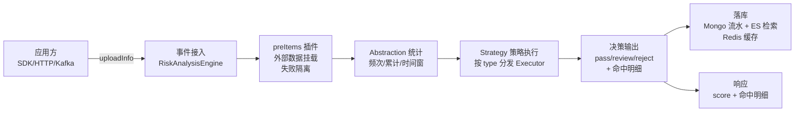
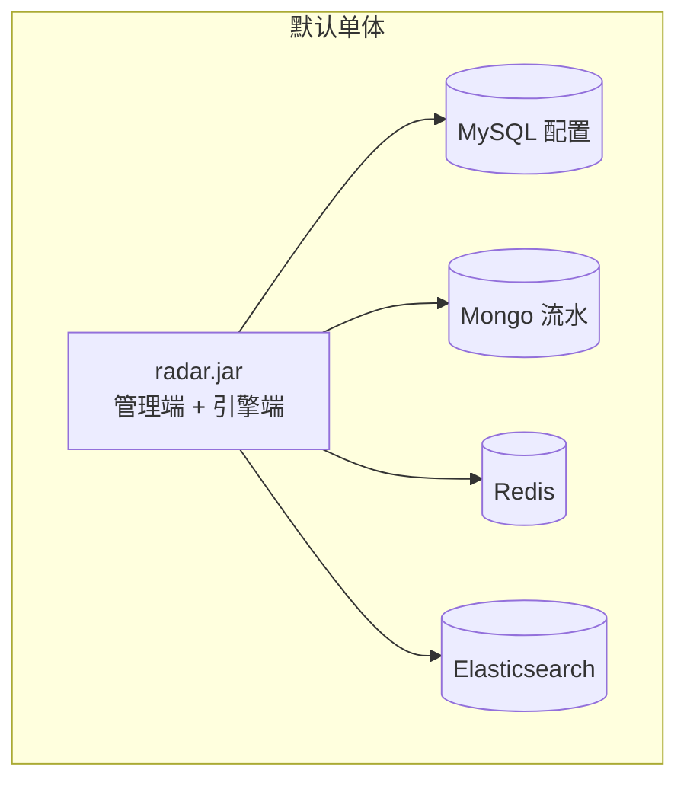

# 架构总览

Radar 是单体应用（一个 jar 同时提供管理端与引擎端 API），Java 17 + Spring Boot 3.5 + MyBatis-Plus，
存储 MySQL（配置）+ MongoDB（事件流水）+ Redis（缓存/配置推送）+ Elasticsearch（事件检索）。

## 事件处理流

一笔事件从接入到决策的完整路径（毫秒级，各阶段耗时已暴露 `/actuator/prometheus`）：



要点：

- **preItems 插件**在策略运算前把外部数据（归属地、数据服务等）挂进事件上下文，单个插件失败被隔离
  （错误标记 + 指标，事件链路继续），插件以外置 jar 形态自助接入，见[插件开发指南](./plugin-dev-guide.md)；
- **策略类型执行器（v4.0）**：引擎编排层遍历 ACTIVE 策略，按 `engine_strategy.TYPE` 分发到
  `StrategyExecutorRegistry`（范式对齐 PluginManager）。首批三类：**规则集**（RULE_SET，Groovy
  条件求和 + 阈值决策，明细存 engine_rule）、**评分卡**（SCORECARD，DEFINITION JSON 特征分箱
  加权求和 + 阈值决策）、**决策树**（DECISION_TREE，DEFINITION JSON 路径走查、叶节点直出决策）。
  扩展新类型 = 新增 StrategyExecutor bean + 枚举值，编排层零改动；单策略执行异常按策略隔离；
- **规则 Groovy 脚本 / 评分卡 / 决策树**管理端编辑保存即生效（Redis pub/sub 推送，无需重启）；
- 各阶段耗时指标：`radar_engine_stage_seconds{stage}`、插件级 `radar_plugin_seconds{plugin}`、
  策略级 `radar_strategy_executions_total{type,result}`。

## 部署形态

单体为默认形态；v3.1 起管理端可完成插件全生命周期运维，模型可导出策略包迁移。



- **一键环境**：`docker compose up -d`（中间件 + 种子数据），`--profile app` 加应用镜像，
  `--profile monitoring` 加 Prometheus/Grafana 看板（见[运维手册](./operations.md)）；
- **水平扩展**：引擎端无状态（配置经 Redis pub/sub 推送），可直接多副本；
  引擎/管理端分离部署 profile 在 [Roadmap](./roadmap.md) P1-6 规划中；
- **插件分发**：`plugins/` 目录外置 jar（管理端上传热重载）；
- **策略分发**：模型导出策略包 JSON，任意实例导入为新模型（见[模型策略包](./model-package.md)）。

## 代码地图

```
src/main/java/com/pgmmers/radar
  ├ controller/admin   管理端 API（模型/字段/规则/插件/策略包…）
  ├ service/impl/engine   引擎核心（adaptation/activation/插件执行链）
  ├ service/impl/model   模型域（含 transfer 策略包）
  ├ service/impl/dnn     Estimator 容器（ML 预留，零实现）
  └ common/util          Groovy/Crypt 等工具
radar-plugin-api / radar-plugin-testkit   插件 SDK（独立工程，已上 Maven Central）
frontend/               React 18 + antd 5 管理端（产物内嵌 jar）
```
